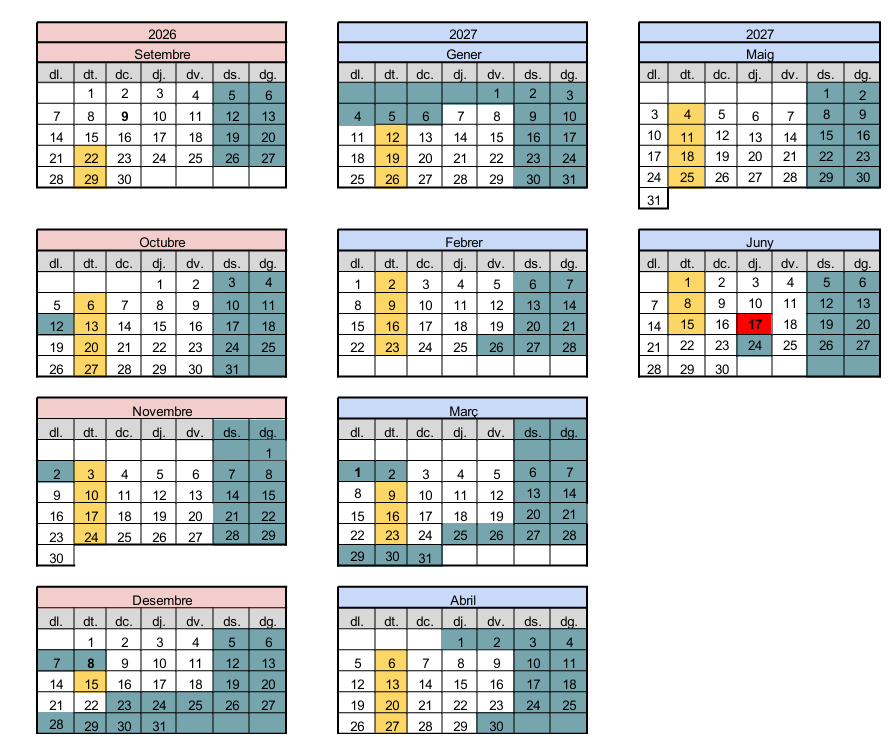

# 📘 Digitalización aplicada a los sectores productivos – 1º de GM

### Profesora: Vanesa Maldonado

Bienvenidos al repositorio oficial de la asignatura **Digitalización aplicada a los sectores productivos** del ciclo de **Sistemes Microinformàtics i Xarxes (SMX)**, curso 2026–2027.

<p align="center">
  
</p>

---

## 🧩 Resultados de Aprendizaje (RA)

RA1. Establece las diferencias entre la Economía Lineal (EL) y la Economía Circular (EC), identificando las ventajas de la EC en relación con el medioambiente y el desarrollo sostenible.
RA 2. Caracteriza los principales aspectos de la 4.ª Revolución Industrial indicando los cambios y las ventajas que se producen tanto desde el punto de vista de los clientes como de las empresas.
RA 3. Identifica la estructura de los sistemas basados en cloud/nube describiendo su tipología y campo de aplicación
RA4. Compara los sistemas de producción/prestación de servicios digitalizados con los sistemas clásicos identificando las mejoras introducidas.
RA5. Elabora un plan de transformación de una empresa clásica del sector en el que se enmarca el título, basada en una EL, al concepto 4.0, determinando los cambios a introducir en las principales fases del sistema e indicando cómo afectaría a los recursos humanos.

---

## 🗂️ Estructura del repositorio

digitalizacion/
├── tema1/ Unidad 1 · Economía Circular (RA1 y RA2)
├── tema2/ Unidad 2 · Sistemas digitalizados y THD (RA4)
├── tema3/ Unidad 3 · La nube (RA3)
├── tema4/ Unidad 4 · Plan de transformación digital de la pyme (RA5)

---

## 📚 Unidades del curso

#### **Unidad 1 – Economía circular**

📁 [`unidad1_economia_circular`](unidad1_economia_circular)

#### **Unidad 2 – Sistemas digitalizados y tecnologías habilitadoras**

📁 [`unidad2_sistemas_digitalizados_tech_habilitadora`](unidad2_sistemas_digitalizados_tech_habilitadora)

#### **Unidad 3 – La nube**

📁 [`unidad3_la_nube`](unidad3_la_nube)

#### **Unidad 4 – Plan de transformación digital de la pyme**

📁 [`unidad4_plan_transformacion_digital`](unidad4_plan_transformacion_digital)

## 🧩 Criterios de evaluación

En este módulo **no hay exámenes durante el curso**. La nota sale de las **actividades** que se entregan.

<div align="center">

$$\Large \textcolor{green}{\textbf{ACTIVIDADES}}$$

</div>

Todas las actividades se evalúan **sobre 10** con la rúbrica que aparece en su enunciado.

Es **obligatorio obtener un mínimo de 5 en cada actividad**. Si una actividad tiene menos de un 5 o no se entrega, el resultado de aprendizaje (RA) al que pertenece queda suspendido, y también la evaluación correspondiente, **aunque la media salga aprobada**. Solo tendrás que recuperar los RA suspendidos.

Cada actividad pertenece a un RA:

| RA  | Contenido                      | Actividades                                        |
| :-: | :----------------------------- | :------------------------------------------------- |
| RA1 | Economía circular              | AC101                                              |
| RA2 | Industria 4.0                  | AC102                                              |
| RA3 | La nube                        | AC301 a AC305 y reto Nube experta                  |
| RA4 | Tecnologías habilitadoras      | AC201 a AC207                                      |
| RA5 | Plan de transformación digital | AC103, AC401 a AC403 y reto Plan de digitalización |

Los cuestionarios y las actividades que hacemos en clase entre todos son de repaso y **no tienen nota**.

<div align="center">

$$\Large \textcolor{green}{\textbf{NORMAS DE ENTREGA}}$$

</div>

- **Con retraso sin justificar o sin entregar**: **0**.
- Una actividad corregida **no se puede volver a entregar** para subir nota.
- En las actividades en pareja, **cada miembro sube su copia** a su rama.

<div align="center">

$$\Large \textcolor{green}{\textbf{USO DE LA IA}}$$

</div>

Puedes usar la IA para entender conceptos o buscar ideas, pero las respuestas tienen que estar **escritas con tus palabras** y **revisadas**. Se resta nota por:

- Texto de IA copiado y pegado o frases iguales a las de otros compañeros: **hasta −2 puntos**.
- No usar la plantilla o formato que indica el enunciado: **−1 punto**.
- Entregar sin nombre o sin revisar (texto cortado, rayas de la plantilla sin borrar…): se descuenta en la presentación.

Una actividad copiada de un compañero o hecha íntegramente por la IA, sin trabajo propio, tendrá un **0**.

<div align="center">

$$\Large \textcolor{red}{\textbf{¿Cómo se calcula la nota final?}}$$

</div>

La nota de cada evaluación es la **media de todas las actividades que se han hecho en ese periodo**, sea cual sea su RA:

- **1.ª evaluación**: hasta el 10 de diciembre.
- **2.ª evaluación**: del 10 de diciembre al 15 de marzo.
- **Ordinaria**: del 15 de marzo a junio.

Por ejemplo, si en la 1.ª evaluación has hecho cinco actividades y todas tienen un 5 o más:

```
  - Notas: 7 + 6 + 8 + 5 + 9 = 35
  - Media: 35 / 5 = 7
  - Nota de la evaluación: 7
```

Si una de esas actividades tuviera un 4, la evaluación estaría suspendida aunque la media fuera un 5 o más.

Recuerda que para aprobar es necesario tener **todas las actividades con un 5 o más**. Si alguna está suspendida o sin entregar, harás en junio un **examen teórico de recuperación**, pero solo de los RA pertenecientes a las actividades suspendidas.
