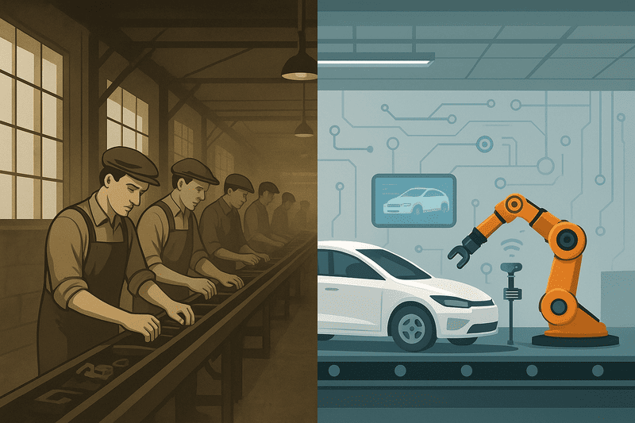
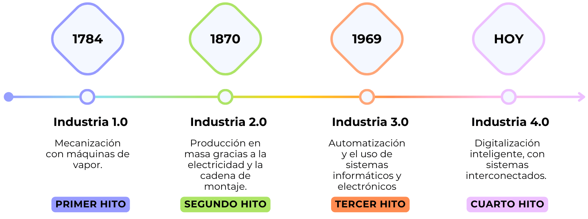
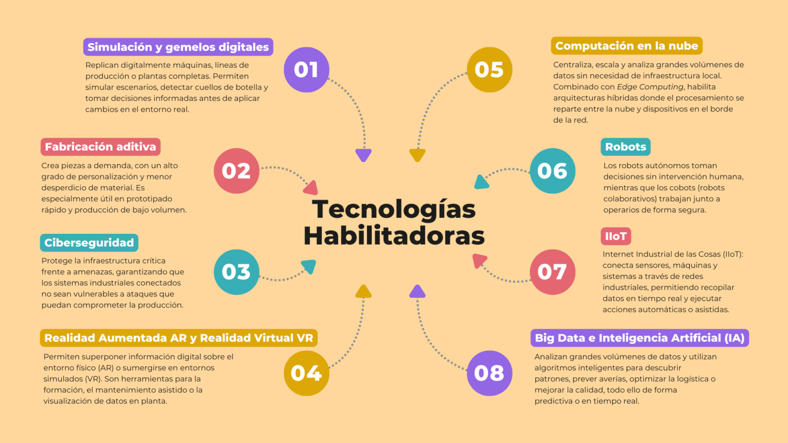

# La cuarta revolución industrial

La Industria 4.0 es la protagonista de la transformación digital en el sector industrial. Representa un cambio en la manera en que se diseñan, fabrican y distribuyen productos. Gracias a la incorporación de tecnologías como el Internet de las Cosas (IoT), la Inteligencia Artificial (IA) o la robótica, las fábricas evolucionan hacia entornos más inteligentes, conectados y automatizados.

---
>[!IMPORTANT]
> <strong>De la cadena de montaje a la fábrica inteligente</strong>
>
>💡 Imagina que estás en una fábrica de coches en 1913, el año en que Henry Ford (fundador de la compañía Ford Motor) revolucionó la producción con la cadena de montaje. Ves a decenas de personas alineadas, cada una montando una pieza de manera repetitiva, con ruido de martillos y olor a aceite. Ahora, da un salto mental al presente: en algunas plantas de Tesla, un coche puede “decidir” por sí mismo en qué estación debe estar porque una red de sensores e inteligencia artificial ha detectado un fallo en una pieza, y los robots ya se han reorganizado para solucionarlo sin que nadie les diga nada. Y esto es industria 4.0 porque combina automatización avanzada, conectividad en tiempo real y análisis de datos para que las máquinas tomen decisiones inteligentes, optimicen procesos y reduzcan tiempos de inactividad sin intervención humana directa.
>

>  
>

>
---

## 1. ¿Qué es la Industria 4.0?

El concepto de **Industria 4.0** fue acuñado en 2011 durante la *Feria de Hannover*, como parte de una iniciativa estratégica del gobierno alemán para reforzar la competitividad industrial mediante tecnologías digitales. Desde entonces, se ha convertido en un término clave para describir la transformación radical que están experimentando las fábricas y los modelos productivos en todo el mundo.

Se denomina **4.0** porque representa la cuarta revolución industrial, una evolución natural tras tres grandes hitos en la historia de la industria:

🔵 **1.0 – Finales del siglo XVIII**: mecanización con energía hidráulica y máquinas de vapor.  
🟢 **2.0 – Finales del siglo XIX**: producción en masa gracias a la electricidad, el motor eléctrico y la cadena de montaje.  
🟠 **3.0 – Segunda mitad del siglo XX**: automatización mediante sistemas electrónicos, controladores lógicos programables (PLC) e informática industrial.  
🟣 **4.0 – Siglo XXI**: digitalización inteligente con sistemas ciberfísicos, sensores IoT, inteligencia artificial, robótica avanzada, computación en la nube y análisis de datos en tiempo real.  

  

>[!NOTE]
>Hoy, más del 70% de las grandes empresas manufactureras europeas han iniciado procesos de transformación digital, aunque muchas siguen en fases piloto, probando tecnologías y modelos de adopción gradual.
>

## 2. El papel de los sistemas ciberfísicos (CPS)

Los **sistemas ciberfísicos (CPS, cyber-physical system)** son el núcleo de la Industria 4.0. Se trata de sistemas que integran máquinas, sensores, software y redes de comunicación, uniendo el mundo físico y el digital para controlar procesos de manera inteligente.

🔧 Sensores captan datos del entorno → 📡 los procesa el software avanzado / IA → ⚙️ los actuadores realizan acciones físicas.

Los CPS captan datos del entorno mediante sensores, los procesan con software avanzado y actúan sobre el mundo real a través de actuadores. Además, se comunican con otros sistemas, creando una red inteligente capaz de aprender y adaptarse.

Ejemplos de sistemas ciberfísicos:

* **Vehículos autónomos**, que perciben el entorno y toman decisiones sin intervención humana.
* **Robots colaborativos (cobots)**, que ajustan su comportamiento al trabajar junto a operarios.
* **Drones de inspección**, que recopilan datos en zonas difíciles y envían información en tiempo real.
* **Líneas de producción inteligentes**, donde sensores IoT detectan fallos, la IA analiza datos y los actuadores corrigen el proceso automáticamente.
* **Sistemas domésticos inteligentes**, como termostatos que aprenden hábitos y regulan la temperatura.

Los CPS son el elemento que diferencia la Industria 4.0 de revoluciones anteriores: permiten que los procesos industriales sean autónomos, inteligentes y adaptables.

## 3. ¿Por qué la Industria 4.0 está transformando la producción?

La Industria 4.0 no solo automatiza, sino que transforma la forma de producir. Gracias a la integración de tecnologías digitales con procesos físicos, las empresas pueden tomar decisiones en tiempo real, anticipar fallos, personalizar productos y reducir desperdicios.

El cambio en la automatización es profundo: las máquinas ya no solo siguen instrucciones, ahora aprenden, se adaptan y colaboran con las personas. Esto permite procesos flexibles, mantenimiento predictivo y reducción de errores. Cada vez más pymes incorporan estas soluciones para mantenerse competitivas en un mercado global.

## 4. ¿Qué retos busca resolver la Industria 4.0?

En un mercado cada vez más competitivo, las empresas necesitan:

* **Reducir costes y aumentar eficiencia**, gracias a la automatización de procesos y la optimización de recursos.
* **Flexibilizar la producción para adaptarse a la demanda**, permitiendo personalizar productos a gran escala.
* **Obtener trazabilidad total de los procesos**, detectando fallos en tiempo real y anticipando problemas de mantenimiento.
* **Tomar decisiones más rápidas y basadas en datos**, con información en tiempo real de toda la cadena productiva.
* **Reducir el impacto medioambiental**, aplicando soluciones inteligentes que optimizan el uso de energía y materiales.

---

$$\Large \textcolor{green}{\textbf{Actividad: ¿Cuánto has entendido sobre la Industria 4.0?}}$$

| ⚡ [Ir a la actividad: ¿Cuánto has entendido sobre la Industria 4.0?](https://smx-26-27.github.io/cuestionarios_digitalizacion/actividad-industria40/) |
| :---: |

---

## 5. Tecnologías habilitadoras: cómo se unen el mundo físico y el virtual en la Industria 4.0

Las **tecnologías habilitadoras** son las herramientas que hacen posible el funcionamiento de los sistemas ciberfísicos. Gracias a ellas, máquinas, datos y software trabajan de forma integrada, permitiendo una conexión total entre el mundo físico y el digital.

Principales tecnologías habilitadoras:

* **Simulación y gemelos digitales**: replican digitalmente máquinas, líneas de producción o plantas completas. Permiten simular escenarios, detectar cuellos de botella y tomar decisiones informadas antes de aplicar cambios en el entorno real.
* **Fabricación aditiva (impresión 3D)**: crea piezas a demanda, con un alto grado de personalización y menor desperdicio de material.
* **Ciberseguridad industrial**: protege la infraestructura crítica frente a amenazas, garantizando que los sistemas industriales conectados no sean vulnerables a ataques que puedan comprometer la producción o los procesos.
* **Realidad aumentada (AR) y realidad virtual (VR)**: permiten superponer información digital sobre el entorno físico (AR) o sumergirse en entornos simulados (VR). Son herramientas para la formación, el mantenimiento asistido o la visualización de datos en planta.
* **Computación en la nube (Cloud Computing)**: centraliza, escala y analiza grandes volúmenes de datos sin necesidad de infraestructura local. Combinado con edge computing, habilita arquitecturas híbridas donde el procesamiento se reparte entre la nube y dispositivos en el borde de la red.
* **Robots autónomos y colaborativos**: los robots autónomos toman decisiones sin intervención humana, mientras que los cobots (robots colaborativos) trabajan junto a operarios de forma segura. Ambos mejoran la productividad y asumen tareas repetitivas o de alta precisión.
* **Internet Industrial de las Cosas (IIoT)**: conecta sensores, actuadores, máquinas y sistemas a través de redes industriales, permitiendo recopilar datos en tiempo real y ejecutar acciones automáticas o asistidas para mejorar el control y la eficiencia operativa.
* **Big Data e Inteligencia Artificial (IA)**: analizan grandes volúmenes de datos y utilizan algoritmos inteligentes para descubrir patrones, prever averías, optimizar la logística o mejorar la calidad, todo ello de forma predictiva o en tiempo real.

  

Estas tecnologías están redefiniendo la forma de producir, interconectar y mantener los sistemas industriales. Y no son las únicas: otras emergentes como el 5G, la computación cuántica o incluso el metaverso industrial están empezando a ganar terreno.

>[!NOTE]
> 🧠 Curiosidad: El uso de IA para inspección de calidad ha logrado detectar defectos en productos que eran invisibles al ojo humano… ¡y en fracciones de segundo!
> 

---

$$\Large \textcolor{green}{\textbf{Actividad: Une cada término con su descripción}}$$

| ⚡ [Ir a la actividad: Actividad: Une cada término con su descripción](https://smx-26-27.github.io/cuestionarios_digitalizacion/actividad_revoluciones_4_0_5_0/) |
| :---: |

---

## 6. Ejemplos reales de transformación

Una de las primeras cosas que empezamos a ver en nuestros hogares con IoT son las persianas inteligentes. Por ejemplo, estas persianas detectan la luz, responden automáticamente y se pueden controlar de forma remota. En una fábrica, los sensores IoT hacen lo mismo con las máquinas: detectan temperatura, presión, vibraciones o niveles de producción, y los sistemas pueden ajustar procesos automáticamente, avisar de mantenimiento o coordinar distintas máquinas sin intervención humana constante.

Esto es un ejemplo de industria 4.0: la aplicación de tecnologías conectadas y automatización en los procesos productivos para mejorar la eficiencia, reducir errores y optimizar recursos. Así como en casa el IoT nos facilita la vida, en la industria permite que las fábricas “piensen” y reaccionen de forma inteligente a lo que está pasando en tiempo real.

Veamos algunos ejemplos:

* **General Electric** fue una de las primeras en integrar sensores IoT en sus turbinas y motores para anticipar el mantenimiento y reducir paradas no planificadas.
* **Bosch**, en sus fábricas alemanas, ha implementado gemelos digitales y análisis de datos que mejoran la calidad y eficiencia de producción.
* **SEAT** en España ha desplegado una red de robots autónomos y sistemas de trazabilidad que optimizan la logística interna.
* **Tesla** aplica algoritmos de IA para ajustar parámetros de fabricación casi en tiempo real según la demanda y los componentes disponibles.

En todos estos casos, los sistemas ciberfísicos coordinan las tecnologías habilitadoras, logrando que máquinas, software y datos trabajen de manera integrada.

## 7. ¿Y después qué? Industria 5.0 en el horizonte

Mientras muchas empresas aún transitan hacia la Industria 4.0, ya se empieza a hablar de la siguiente evolución: **la Industria 5.0**. Este nuevo enfoque busca reintroducir al ser humano en el centro del sistema productivo, no como fuerza de trabajo manual, sino como diseñador, supervisor y decisor. También se prioriza la sostenibilidad, la resiliencia (la capacidad de adaptarse y recuperarse rápidamente ante problemas o cambios) y la personalización extrema.

No se trata de una ruptura con la Industria 4.0, sino de una evolución donde la tecnología se adapta a las personas y no al revés.

## 8. Industria 4.0 y sostenibilidad

Uno de los grandes aportes de la **Industria 4.0** es su capacidad para hacer que la producción sea no solo más eficiente, sino también más sostenible. Al permitir un control más preciso de los procesos y un uso optimizado de los recursos, muchas empresas están consiguiendo reducir su huella ambiental sin sacrificar productividad.

Gracias al análisis de datos en tiempo real, es posible detectar desperdicios, evitar sobreproducción o ajustar el consumo energético según la demanda. Además, los sistemas predictivos ayudan a alargar la vida útil de las máquinas y reducir el mantenimiento innecesario. Como resultado, se generan nuevos modelos de negocio sostenibles.

Por ejemplo, una fábrica que utiliza sensores IoT puede saber exactamente cuánta energía consume cada línea de producción y actuar de inmediato si detecta un uso anómalo. O una empresa de alimentación puede adaptar su producción diaria a la demanda real y evitar excedentes que terminarían en la basura.

## 9. ¿Y los retos de sostenibilidad?

Aunque la Industria 4.0 ofrece muchas oportunidades para reducir el impacto ambiental, también plantea nuevos desafíos que conviene tener en cuenta:

* **Mayor demanda de energía**: el uso intensivo de centros de datos, redes y algoritmos puede aumentar el consumo energético, sobre todo si no está respaldado por fuentes renovables.
* **Fabricación de dispositivos electrónicos**: sensores, chips, robots y otros elementos requieren recursos escasos o contaminantes, lo que puede generar residuos tecnológicos difíciles de reciclar.
* **Obsolescencia tecnológica**: la rapidez con la que avanzan las soluciones digitales puede fomentar el reemplazo prematuro de equipos, aumentando la generación de desechos electrónicos.

Para que la Industria 4.0 sea realmente sostenible, no basta con automatizar o digitalizar. Es fundamental integrar criterios ambientales en el diseño, la gestión y el ciclo de vida de las tecnologías. Solo así será posible construir un modelo productivo que combine eficiencia, innovación y responsabilidad ambiental.

$$\Large \textcolor{green}{\textbf{Actividad Análisis de la implantación tecnológica en la empresa}}$$

| ⚡ [Ir a la Actividad](AC102.md) |
| :---: |

