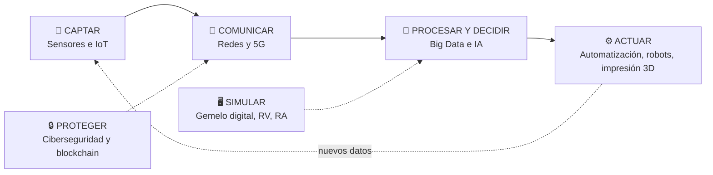

# Las tecnologías habilitadoras digitales por funciones

En la unidad 1 vimos una lista de **tecnologías habilitadoras digitales (THD)**: IoT, Big Data, inteligencia artificial, robots colaborativos, impresión 3D, gemelos digitales… Las conocimos una por una, como si fueran piezas sueltas. Pero en una empresa real **nunca trabajan solas**: se combinan para que los datos recorran un camino completo.

---

> [!IMPORTANT]
> <strong>El camino de un dato</strong>
>
> 💡 Piensa en el sistema ciberfísico que vimos en la unidad 1: **sensor → software → actuador**. Las THD se pueden ordenar siguiendo ese mismo camino. Unas sirven para **captar** datos, otras para **comunicarlos**, otras para **procesarlos y decidir**, y otras para **actuar** sobre el mundo físico. Además, hay tecnologías que acompañan a todo el camino: las que permiten **simular** antes de hacer y las que sirven para **proteger** los datos.

---

## 1. Captar datos: sensores e IoT

Todo empieza con un **dato**. Sin datos, una empresa no puede saber qué está pasando y toma decisiones "a ojo".

Un **sensor** es un dispositivo que mide una magnitud física (temperatura, presión, movimiento…) y la convierte en una señal eléctrica que un ordenador puede leer. Cuando ese sensor está **conectado a una red** y envía sus datos de forma automática, forma parte del **Internet de las cosas (IoT)**. Si hablamos de máquinas y fábricas lo llamamos **IIoT** (Internet Industrial de las Cosas).

|       Tipo de sensor       | ¿Qué mide?                                         | Ejemplo de uso en una empresa                                   |
| :------------------------: | :------------------------------------------------- | :-------------------------------------------------------------- |
|        Temperatura         | Calor de una máquina, de una sala o de un producto | Avisar si una cámara frigorífica de un supermercado se calienta |
|         Vibración          | Movimientos anómalos de un motor                   | Detectar que un motor se va a romper antes de que ocurra        |
|   Presencia / movimiento   | Si hay alguien o algo en una zona                  | Apagar las luces de un almacén cuando no hay nadie              |
|         RFID / NFC         | Etiquetas que se leen sin contacto                 | Saber qué productos hay en cada estantería                      |
| Cámara (visión artificial) | Imágenes                                           | Detectar piezas defectuosas en una cinta                        |
|            GPS             | Posición                                           | Saber dónde está cada furgoneta de reparto                      |
|     Consumo eléctrico      | Energía que gasta un equipo                        | Detectar máquinas que gastan más de lo normal                   |

> [!NOTE]
> En nuestro sector también "captamos datos": un servidor informa de su temperatura, del uso de CPU o del estado de sus discos (S.M.A.R.T.). Un programa de monitorización recoge esos datos igual que un sensor IoT recoge la temperatura de una máquina.

## 2. Comunicar: redes industriales y 5G

Un dato que se queda en el sensor no sirve de nada. Hay que **enviarlo** a donde se va a procesar. Para ello se usan distintas tecnologías de comunicación, según la distancia, la cantidad de datos y la energía disponible.

|         Tecnología          |         Alcance         | ¿Para qué es buena?                            | Ejemplo                                          |
| :-------------------------: | :---------------------: | :--------------------------------------------- | :----------------------------------------------- |
| Cable (Ethernet industrial) |  Dentro de la fábrica   | Máxima fiabilidad, sin interferencias          | Conectar las máquinas de una línea de producción |
|            Wifi             |    Decenas de metros    | Muchos datos en un edificio                    | Tablets de los operarios en el almacén           |
|          Bluetooth          |      Pocos metros       | Dispositivos cercanos y de poco consumo        | Lector de códigos conectado a un móvil           |
|      LoRaWAN / NB-IoT       |       Kilómetros        | Pocos datos, sensores con pilas que duran años | Sensores de humedad repartidos por un campo      |
|           4G / 5G           | Toda la cobertura móvil | Movilidad y muchos dispositivos                | Vehículos, robots móviles, cámaras               |

### ¿Qué tiene de especial el 5G?

El **5G** es la quinta generación de telefonía móvil. No solo es "más rápido" que el 4G; se diseñó pensando en la industria:

- **Más velocidad**: permite enviar vídeo de alta calidad o grandes cantidades de datos.
- **Latencia muy baja**: la latencia es el tiempo que tarda un dato en llegar. El objetivo de diseño del 5G es que sea de muy pocos milisegundos, algo necesario para controlar un robot o un vehículo a distancia sin retrasos.
- **Muchísimos dispositivos a la vez**: está pensado para conectar una enorme cantidad de sensores en la misma zona.
- **Redes privadas y "porciones" de red** (_network slicing_): una fábrica puede tener su propia red 5G o reservar una parte de la red para sus máquinas críticas.

## 3. Procesar y decidir: Big Data e inteligencia artificial

Una fábrica con cientos de sensores genera millones de datos al día. Una persona no puede revisarlos todos. Aquí entran el Big Data y la IA.

### Big Data

**Big Data** es el conjunto de técnicas para guardar y analizar cantidades de datos tan grandes, rápidas o variadas que no se pueden manejar con herramientas normales (como una hoja de cálculo). Se suele explicar con las **5 V**:

|     V     | Significado                       | Ejemplo                                                       |
| :-------: | :-------------------------------- | :------------------------------------------------------------ |
|  Volumen  | Muchísimos datos                  | Todas las compras de una cadena de supermercados durante años |
| Velocidad | Llegan sin parar, en tiempo real  | Lecturas de sensores cada segundo                             |
| Variedad  | De muchos tipos                   | Números, textos, fotos, vídeos, audios                        |
| Veracidad | Hay que comprobar que son fiables | Descartar lecturas de un sensor estropeado                    |
|   Valor   | Solo sirven si ayudan a decidir   | Descubrir qué productos se venden más en verano               |

### Inteligencia artificial (IA)

La **inteligencia artificial** permite que un sistema informático realice tareas que normalmente requieren inteligencia humana: reconocer imágenes, entender textos, predecir o recomendar. En la empresa se usa sobre todo el **aprendizaje automático** (_machine learning_): el sistema aprende patrones a partir de muchos ejemplos.

Usos habituales:

- **Mantenimiento predictivo**: la IA aprende cómo vibra un motor sano y avisa cuando empieza a vibrar como uno que se va a romper.
- **Visión artificial**: revisa piezas o productos con una cámara y detecta defectos.
- **Previsión de la demanda**: estima cuánto se va a vender para no fabricar ni comprar de más.
- **IA generativa**: redacta textos, resume documentos o atiende consultas sencillas de clientes (chatbots).

> [!IMPORTANT]
> Big Data e IA van de la mano: el **Big Data aporta los datos** y la **IA aprende de ellos**. Una IA entrenada con datos malos o insuficientes toma malas decisiones.

## 4. Actuar: automatización, robótica y fabricación aditiva

Cuando el sistema ya ha decidido qué hacer, hay que **actuar sobre el mundo físico**.

- **Automatización**: máquinas controladas por autómatas programables (PLC) que realizan tareas sin intervención humana continua: abrir una válvula, encender un motor, mover una cinta.
- **Robots industriales**: brazos robóticos que sueldan, pintan o montan piezas con gran rapidez y precisión. Suelen trabajar dentro de una zona vallada.
- **Robots colaborativos (cobots)**: trabajan **junto a las personas** sin vallas. Tienen sensores que los detienen si tocan a alguien.
- **Robots móviles autónomos (AMR)**: se desplazan solos por un almacén o una fábrica llevando material, esquivando obstáculos.
- **Fabricación aditiva (impresión 3D)**: crea objetos añadiendo material capa a capa. Se usa para prototipos, piezas personalizadas o recambios que ya no se fabrican.

> [!NOTE]
> En informática también "actuamos" de forma automática: un script que reinicia un servicio caído o un programa que instala actualizaciones por la noche son automatizaciones.

## 5. Simular: gemelo digital, realidad virtual y realidad aumentada

Antes de cambiar algo en el mundo real, a veces es mejor probarlo en un ordenador.

|       Tecnología        | ¿Qué es?                                                                                    | Ejemplo                                                                |
| :---------------------: | :------------------------------------------------------------------------------------------ | :--------------------------------------------------------------------- |
|     Gemelo digital      | Copia virtual de una máquina, una línea o una fábrica que se actualiza con los datos reales | Probar si añadir un robot más acelera la producción antes de comprarlo |
|  Realidad virtual (RV)  | Te sumerge en un entorno totalmente simulado con unas gafas                                 | Formar a un operario en una máquina peligrosa sin riesgo               |
| Realidad aumentada (RA) | Añade información digital sobre lo que ves de verdad (móvil, tablet o gafas)                | Un técnico ve sobre el equipo real qué tornillo quitar y en qué orden  |

## 6. Proteger y dar confianza: ciberseguridad y blockchain

Cuanto más conectada está una empresa, más puertas de entrada tiene para un ataque.

### Ciberseguridad industrial

La **ciberseguridad** protege equipos, redes y datos frente a accesos no autorizados, robos o sabotajes. En la industria hay que proteger dos mundos:

- **IT** (tecnologías de la información): ordenadores, servidores, correo, datos de clientes.
- **OT** (tecnologías de operación): máquinas, autómatas, sensores. Un ataque aquí puede **parar la producción** o incluso provocar accidentes.

### Blockchain

**Blockchain** (cadena de bloques) es un registro de datos **compartido entre muchos ordenadores** en el que la información se guarda en bloques encadenados. Cada bloque contiene una "huella" del anterior, por lo que **no se puede modificar un dato antiguo sin que se note**.

No sirve solo para las criptomonedas. En la empresa se usa para:

- **Trazabilidad**: seguir un alimento desde el campo hasta el supermercado.
- **Certificados**: títulos, garantías o certificados de origen que no se pueden falsificar.
- **Contratos inteligentes**: acuerdos que se ejecutan solos cuando se cumple una condición (por ejemplo, pagar al proveedor cuando el sensor confirma que la mercancía ha llegado).

---

$$\Large \textcolor{green}{\textbf{Cuestionario: ¿Sabemos las verdades de las THD?}}$$

| ⚡ [Ir al cuestionario](https://smx-26-27.github.io/cuestionarios_digitalizacion/verdades_thd/) |
| :---------------------------------------------------------------------------------------------: |

---

$$\Large \textcolor{green}{\textbf{Actividad AC201: ¿Qué THD se nos ha olvidado?}}$$

| ⚡ [Ir a la Actividad](./actividades/AC201.md) |
| :--------------------------------------------: |

---

$$\Large \textcolor{green}{\textbf{Actividad AC202: Sigue el dato}}$$

| ⚡ [Ir a la Actividad](./actividades/AC202.md) |
| :--------------------------------------------: |

