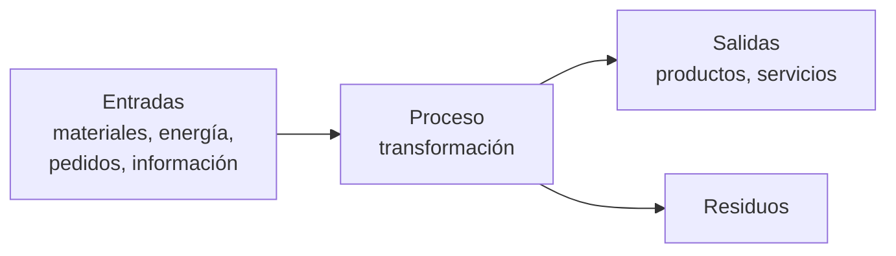
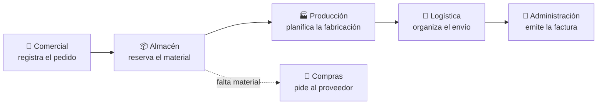

# Las THD en la empresa y en los sectores productivos

Ya sabemos qué hace cada tecnología. Ahora la pregunta es otra: **¿dónde se usan dentro de una empresa y en qué sectores están cambiando la forma de trabajar?**

## 1. Del sistema clásico al sistema digitalizado

Un **sistema productivo** es el conjunto de recursos (personas, máquinas, materiales, información) que una empresa organiza para fabricar un producto o prestar un servicio. Cualquier sistema productivo tiene **entradas** (materias primas, energía, pedidos), un **proceso** que las transforma y unas **salidas** (productos, servicios, residuos).

La diferencia entre un sistema **clásico** y uno **digitalizado** no está en lo que fabrican, sino en **cómo circula la información**:

| Aspecto | Sistema clásico | Sistema digitalizado |
|:---:|:---|:---|
| Información | En papel o en archivos sueltos de cada persona | En un sistema común al que acceden todos |
| Decisiones | Por experiencia o "a ojo" | Basadas en datos, muchas en tiempo real |
| Mantenimiento | Se repara cuando se rompe | Se anticipa la avería |
| Relación con el cliente | Teléfono, tienda física | Varios canales conectados (web, app, tienda) |
| Departamentos | Cada uno trabaja por su cuenta | Comparten datos y objetivos |

## 2. Las unidades funcionales de una empresa

Una empresa se organiza en **unidades funcionales** o departamentos. Cada una tiene su función, pero todas deben trabajar **alineadas con el mismo objetivo**: dar al cliente un buen producto o servicio con el menor coste posible.

| Unidad funcional | ¿Qué hace? | THD que suele usar | Ejemplo |
|:---:|:---|:---|:---|
| Dirección | Fija objetivos y toma decisiones estratégicas | Big Data, cuadros de mando (*dashboards*) | Ver en una pantalla las ventas y costes del día |
| Compras / aprovisionamiento | Compra materiales y gestiona proveedores | ERP, IA de previsión de demanda | El sistema pide material solo cuando queda poco |
| Producción / operaciones | Fabrica el producto o presta el servicio | IoT, automatización, robots, gemelo digital | Una línea que se ajusta sola al pedido |
| Logística y almacén | Guarda y mueve mercancías | RFID, robots móviles, GPS | Saber en tiempo real qué hay en cada estantería |
| Comercial y atención al cliente | Vende, hace publicidad y atiende dudas | CRM, comercio electrónico, chatbots, redes sociales | Un chatbot resuelve dudas fuera de horario |
| Administración y finanzas | Facturas, pagos, impuestos, nóminas | ERP, factura electrónica, automatización | Las facturas se generan y envían solas |
| Recursos humanos | Selecciona, forma y organiza al personal | Plataformas de formación en línea, RV | Formar en una máquina con gafas de RV |
| Sistemas / informática | Mantiene equipos, redes y seguridad | Nube, ciberseguridad, monitorización | Detectar un ataque antes de que cause daños |

### ¿Qué significa que estén "alineadas"?

En un sistema clásico, cada departamento tiene su propia información. Ventas promete un plazo que producción no puede cumplir porque no sabe que falta material; administración factura tarde porque nadie le avisa de que el pedido ha salido.

En un sistema digitalizado, **un mismo dato recorre toda la empresa**. Normalmente gracias a un **ERP** (programa de gestión que integra todos los departamentos):

>[!IMPORTANT]
>La digitalización no consiste en que cada departamento tenga su programa, sino en que **todos compartan la misma información**. Si cada uno usa una herramienta distinta que no se comunica con las demás, la empresa sigue funcionando como un sistema clásico.

## 3. Tecnologías disruptivas por sectores

Una **tecnología disruptiva** es la que cambia por completo la forma de hacer algo y deja anticuada la forma anterior. La fotografía digital hizo desaparecer casi por completo los carretes; las plataformas de streaming cambiaron cómo vemos series y películas.

Cada sector productivo aprovecha las THD de forma distinta:

| Sector | Ejemplos de uso de las THD |
|:---:|:---|
| 🏭 Industria | Mantenimiento predictivo, cobots en el montaje, gemelos digitales de la fábrica, impresión 3D de piezas |
| 🌾 Agricultura y ganadería | Sensores de humedad que deciden cuándo regar, drones que detectan plagas, tractores guiados por GPS, collares que controlan la salud del ganado |
| 🛍️ Comercio | Tienda online, cajas de autopago, etiquetas electrónicas de precios, recomendaciones personalizadas con IA |
| 🏨 Turismo y hostelería | Reservas y check-in desde el móvil, llaves digitales, precios que cambian según la demanda, control de consumo de energía y agua por habitación |
| 🏥 Salud | Historia clínica electrónica, telemedicina, IA que ayuda a interpretar radiografías, impresión 3D de prótesis |
| 🚚 Logística y transporte | Seguimiento de envíos en tiempo real, robots en almacenes, optimización de rutas con IA |
| 🏗️ Construcción | Modelado digital de edificios (BIM), drones para inspeccionar obras, RA para ver el proyecto sobre el terreno |
| 💻 Servicios informáticos | Monitorización remota de equipos, soporte por acceso remoto, sistemas de tickets, IA en el soporte técnico, nube |

>[!NOTE]
>🧠 Curiosidad: en muchos almacenes de grandes empresas de comercio electrónico ya no son las personas las que van a buscar los productos a las estanterías: son robots móviles los que llevan la estantería hasta la persona que prepara el pedido.

---

$$\Large \textcolor{green}{\textbf{Actividad AC203: Mapa de la empresa}}$$

| ⚡ [Ir a la Actividad](./actividades/AC203.md) |
| :---: |

---

$$\Large \textcolor{green}{\textbf{Actividad AC204: Ficha de sector}}$$

| ⚡ [Ir a la Actividad](./actividades/AC204.md) |
| :---: |

---

$$\Large \textcolor{green}{\textbf{Actividad AC205: La realidad digital empresarial ★}}$$

| ⚡ [Ir a la Actividad](./actividades/AC205.md) |
| :---: |

